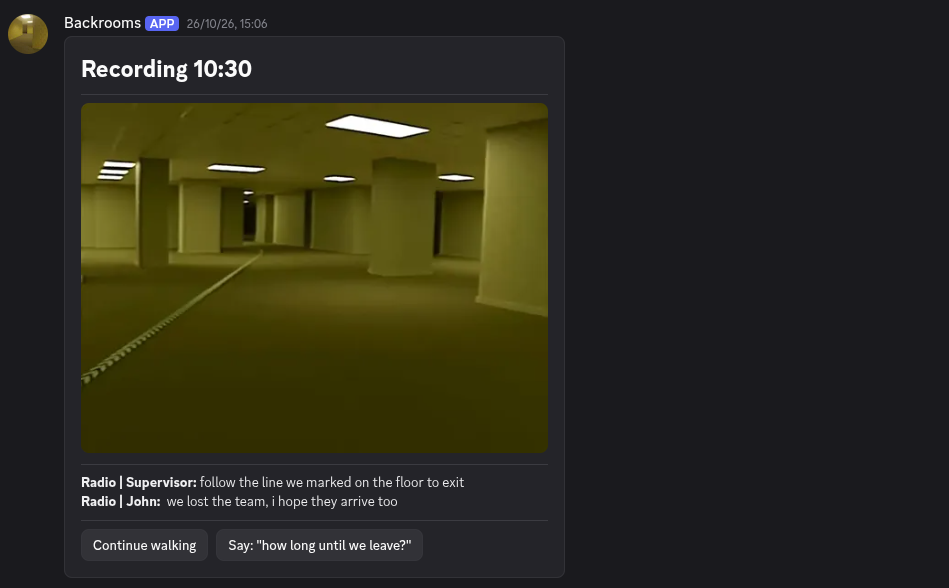

# Backrooms Bot
is obvious but here and in the code have spoilers, if you want play the game first

Discord server: https://discord.gg/RKdQScjgXX

## FAQ
**can i lose?:** No, you can't lose all the decisions don't make you die or something

**does my decisions affect?:** Yes, but not in the long term

**who are the backrooms organization?:** I make me the same question...

# LORE (SPOILER ALERT)

hey!, easter egg, i originaly plan to be like levels, like level 1-2-3, 
but i realize that there aren't a lot of pictures of the pool rooms for example, 
anyways i like the path i choose, here is the lore, only for the people that read this

lore: you enter a neural data collection program of the backrooms org, that's the why are messages like "linking..." hackclub supports this program but it's private, some people has been found in the streets without last memories and with hackclub stickers in their pocket, so no one make questions you never enter the backrooms, your brain enter the backrooms, the alpha neurochip is the device you use, yeah, i know, i create this lore 3 minutes ago but it's cool xd
    